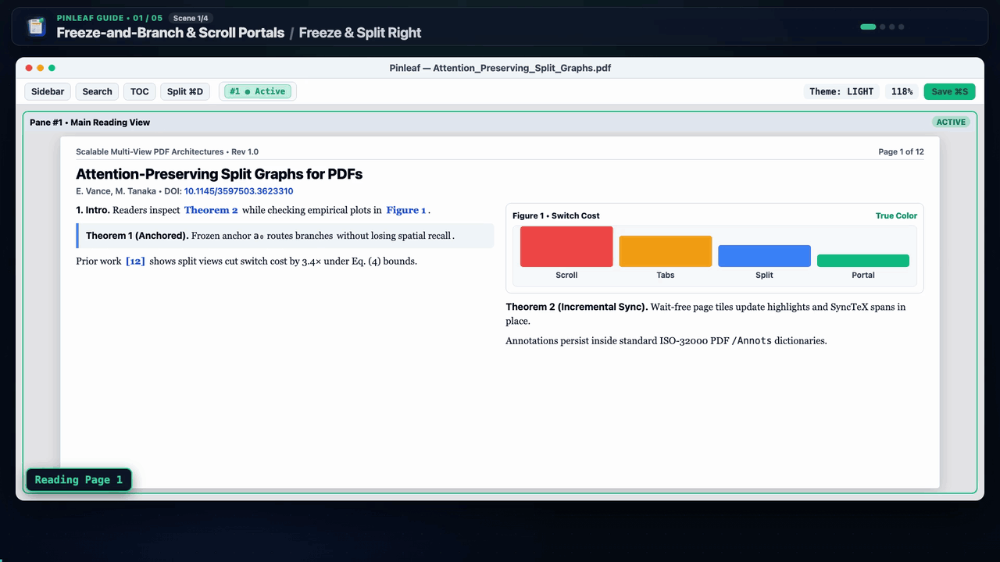
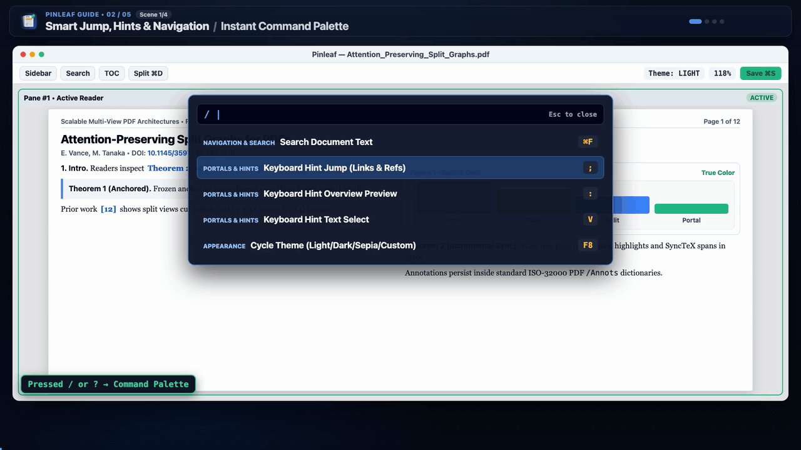
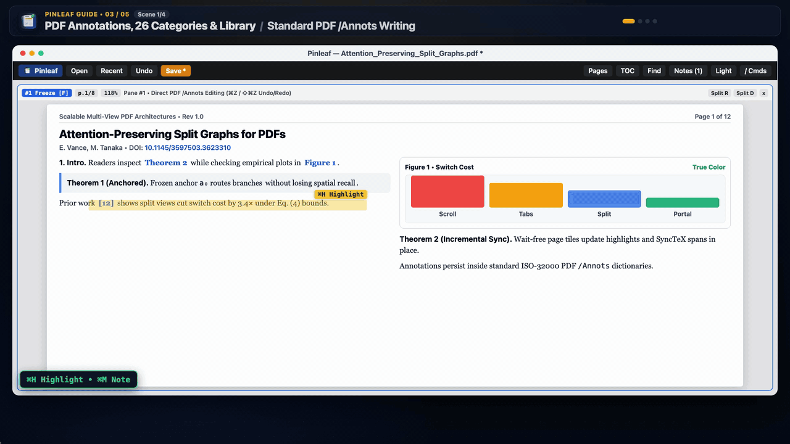
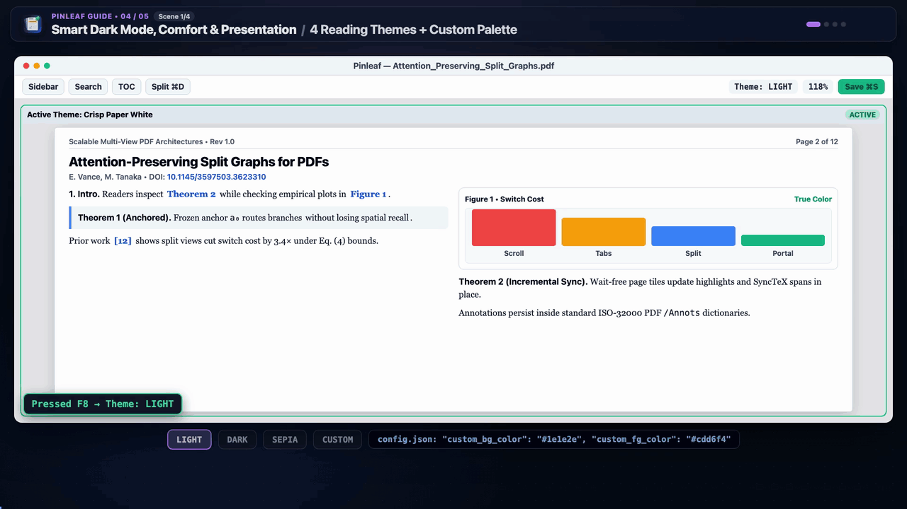
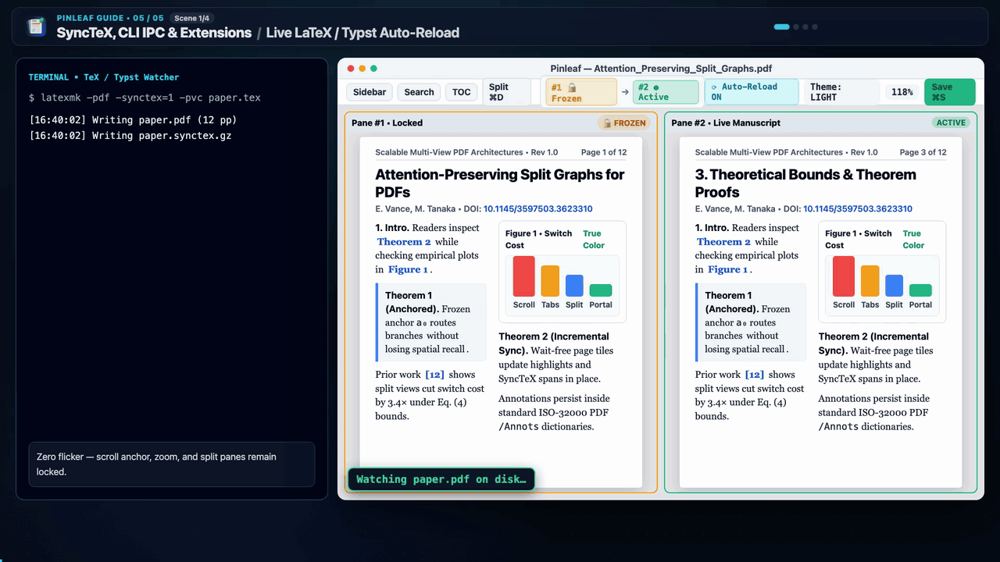

<p align="center">
  
</p>

<h1 align="center">Pinleaf</h1>

<p align="center">
  <strong>Pure-Rust multi-view academic PDF reader with unlimited freeze-and-branch panes, scroll-linked portals, Vimium keyboard hints, two-way SyncTeX, and ISO-32000 PDF annotations.</strong>
</p>

<p align="center">
  <a href="https://github.com/zhanxw/pinleaf/actions/workflows/ci.yml">
    
  </a>
  <a href="https://github.com/zhanxw/pinleaf/actions/workflows/release.yml">
    
  </a>
  <a href="https://github.com/zhanxw/pinleaf/releases">
    
  </a>
</p>

```sh
curl -fsSL https://raw.githubusercontent.com/zhanxw/pinleaf/main/install.sh | sh
```

> Installs the latest Universal (`arm64` + `x86_64`) `Pinleaf.app`, verifies SHA-256 checksums, clears Gatekeeper quarantine, and links the `pinleaf` CLI.

---

## Video Walkthroughs

New to Pinleaf? Browse the full-width feature demos below, stream/download the narrated **1080p `.mp4`** files with voiceover, or read the [Feature Tour & Recipes](docs/FEATURE_TOUR.md).

### 01. Multi-View Freeze-and-Branch & Scroll-Linked Portals (39s)



Freeze source context (`F` / `⌘D`), branch unlimited child panes (`#1 🔒 → #2 🔒 → #3`), smart-route references without scrolling away, and bind scroll-linked portals (`P` / `⇧P`) so helper panes auto-follow figures and equations as you read.
- **1080p Video with Audio:** [Download / Stream 01-freeze-and-portals.mp4](https://github.com/zhanxw/pinleaf/releases/download/v0.2.2/01-freeze-and-portals.mp4) · [`docs/videos/01-freeze-and-portals.mp4`](docs/videos/01-freeze-and-portals.mp4)

### 02. Go-to-Page, Thumbnails, Smart Jump & Hints (44s)



Jump directly via the Command Palette (`/4`), Go-to-Page modal (`⌥⌘G` / `^G`), clickable `p.X/Y` pill, or Vim `<num>G`, browse the virtualized Page Thumbnails strip (`⇧⌘T`) and 4-column Grid (`⌥⌘T`), navigate Overview previews with `Enter` / `S` / `Esc`, use Vimium 2-letter hints (`;` / `:` / `V`), filter Auto-TOC (`T`), regex search (`⌘F`), and scroll with `Space` / `⇧Space`.
- **1080p Video with Audio:** [Download / Stream 02-navigation-smart-jump-hints.mp4](https://github.com/zhanxw/pinleaf/releases/download/v0.2.2/02-navigation-smart-jump-hints.mp4) · [`docs/videos/02-navigation-smart-jump-hints.mp4`](docs/videos/02-navigation-smart-jump-hints.mp4)

### 03. ISO-32000 PDF Annotations, 26 Categories & Library (45s)



Select cleanly across columns to highlight (`⌘H`), add notes (`⌘M`), underline (`U`), strikeout (`S`), or draw figure marquees (`A`) with atomic PDF `/Annots` saves (`⌘S`), tag across 26 highlight categories (`H + a–z`), filter in the Notes Sidebar (`⇧⌘A`), search highlights globally (`⇧⌘F`), or open DOIs on Google Scholar (`⇧⌘K`).
- **1080p Video with Audio:** [Download / Stream 03-annotations-categories-library.mp4](https://github.com/zhanxw/pinleaf/releases/download/v0.2.2/03-annotations-categories-library.mp4) · [`docs/videos/03-annotations-categories-library.mp4`](docs/videos/03-annotations-categories-library.mp4)

### 04. Smart Dark Mode, Comfort & Presentation Mode (42s)



Cycle `Light`, `Dark`, `Sepia`, and `Custom` hex palettes (`F8`), keep raster plots crisp and un-inverted inside dark modes (`⇧F8`), crop side margins (`F10` / `W`), step lines with the Reading Ruler (`R`), stream smoothly with 60 FPS Auto-Scroll (`F6`), and switch to fullscreen Presentation Mode (`F5`).
- **1080p Video with Audio:** [Download / Stream 04-themes-comfort-presentation.mp4](https://github.com/zhanxw/pinleaf/releases/download/v0.2.2/04-themes-comfort-presentation.mp4) · [`docs/videos/04-themes-comfort-presentation.mp4`](docs/videos/04-themes-comfort-presentation.mp4)

### 05. Live Auto-Reload, Two-Way SyncTeX, CLI IPC & Extensions (43s)



Reload edited TeX/Typst PDFs automatically without losing scroll anchors, jump both ways with pure-Rust `.synctex.gz` (`--synctex-forward` / `⌘+Click` / `⇧⌘J`), script live windows over Unix socket IPC (`--execute-command` including `goto_page` and `toggle_thumbnails`), run shell/Python extensions (`⇧⌘E`), and view/copy version details via `Pinleaf` → **About Pinleaf**.
- **1080p Video with Audio:** [Download / Stream 05-synctex-ipc-extensions.mp4](https://github.com/zhanxw/pinleaf/releases/download/v0.2.2/05-synctex-ipc-extensions.mp4) · [`docs/videos/05-synctex-ipc-extensions.mp4`](docs/videos/05-synctex-ipc-extensions.mp4)

---

## Features

- **Unlimited Freeze & Branch Multi-View (`#1 🔒 → #2 🔒 → #3 → …`):**
  Freeze the active reading pane at its exact page, scroll anchor, and zoom scale (`F`), then split right (`⌘D`), split down (`⇧⌘D`), open a new OS window (`⇧⌘N`), or detach panes (`⌥⌘W`) to chase derivations and proofs. Clicking internal links or Smart Jumps inside a frozen pane automatically routes the active descendant viewport.
- **Scroll-Linked Portals (`P`, `⇧P`, `⌥P`):**
  Bind any reading paragraph (or active Overview card) to a figure, table, or equation anchor (`P`), spawn or toggle a `Portal Follower` pane (`⇧P`) that switches targets automatically as you scroll, delete the nearest portal (`⌥P`), and persist portals per PDF in `LibraryStore`.
- **Keyboard-First Navigation, Smart Jump & Vimium Hints:**
  - **Command Palette (`/` or `?`):** Fuzzy-filter all commands, inspect platform shortcuts, or jump straight to a page (`/14`, `/:14`, `/page 14`).
  - **Go to Page & Page Thumbnails (`⌥⌘G` / `⇧⌘T` / `⌥⌘T`):** Jump immediately via the `⌥⌘G` (`^G`) modal, clickable `p.X/Y` header pill, or Vim `<number>G`, browse a virtualized left **Thumbnail Strip** (`⇧⌘T`), or open the **4-Column Thumbnail Grid** (`⌥⌘T`, arrow/`hjkl` nav, `⌘+Click` / `⌘+Enter` to freeze & split right).
  - **Heuristic Smart Jump:** Click unlinked references like `Figure 1`, `Theorem 2`, `Eq. (3)`, or `[12]` to jump, or **Right-Click** for a floating **Overview** preview (`↵` Jump, `S` / `⌘↵` Split, `P` Portal, `Esc` / `X` Close) without scrolling away.
  - **2-Letter Home-Row Hints (`;` / `:` / `V`):** Overlay yellow badges on visible links, smart-jump refs, and words for mouse-free Jump (`;`), Overview (`:`), and two-endpoint Text Select (`V`).
  - **Embedded + Auto-TOC (`T` / `⌘T`), Regex Search (`⌘F`), & Marks (`m` / `` ` ``):** Infer section outlines automatically when `/Outlines` is absent, run `re:` regex queries, save single-key bookmarks, and navigate jump history (`⌘[` / `⌘]`), screen scroll (`Space` / `⇧Space`), or Vim keys (`j`/`k`/`d`/`u`/`g`/`G`).
- **Native ISO-32000 PDF `/Annots` & 26 Typed Highlight Categories (`H + a–z`):**
  Select text across two columns to highlight (`⌘H`), attach inline sticky notes (`⌘M`), underline (`U`), strikeout (`S`), or draw figure area marquees (`A`) with undo/redo (`⌘Z` / `⇧⌘Z`) and atomic incremental writes (`⌘S`) readable by Apple Preview and standard PDF viewers. Tag or re-tag highlights into 26 buckets (`H + a–z`, saved via `/Subj (pinleaf-cat:<ch>)`) and filter in the Notes Sidebar (`⇧⌘A`), Quick-Open Recent (`⌘P`), Global Highlight Search (`⇧⌘F`), or Scholar/DOI lookup (`⇧⌘K`).
- **Smart Dark Mode, Reading Comfort & Presentation Mode:**
  Cycle `Light` / `Dark` / `Sepia` / `Custom` (`F8`), toggle `Smart Dark Mode` (`⇧F8`) so `hayro` preserves raster plots/diagrams un-inverted inside dark & custom themes, crop margins to content width (`F10` / `W`), step lines with the Visual Reading Ruler (`R`), stream smoothly with 60 FPS Auto-Scroll (`F6`, `⌥=` / `⌥-`), and switch to chrome-free fullscreen Presentation Mode (`F5`).
- **Two-Way SyncTeX, CLI IPC & Shell Extensions:**
  800 ms live PDF auto-reload for LaTeX/Typst, pure-Rust `.synctex.gz` forward & inverse search (`⌘+Click` / `⇧⌘J`), private Unix domain socket IPC (`--execute-command`), and shell/Python workflow extensions (`⇧⌘E` + custom `extensions[].key` hotkeys).
- **Pure Rust + Metal GPU UI:**
  Built on `gpui-ce`, `hayro`, `lopdf`, `flate2`, and `resvg`.

---

## Installation (macOS)

### Quick One-Line Install

```sh
curl -fsSL https://raw.githubusercontent.com/zhanxw/pinleaf/main/install.sh | sh
```

- Installs `Pinleaf.app` into `/Applications` (or `~/Applications` if `/Applications` is not writable), verifies `SHA256SUMS.txt`, strips Gatekeeper quarantine, and links `pinleaf` into `/opt/homebrew/bin`, `/usr/local/bin`, or `~/.local/bin`.
- Customize via flags or env vars:
  ```sh
  curl -fsSL https://raw.githubusercontent.com/zhanxw/pinleaf/main/install.sh | sh -s -- --version v0.2.2 --no-cli
  # Env vars: PINLEAF_VERSION, PINLEAF_INSTALL_DIR, PINLEAF_BIN_DIR
  ```

### Manual DMG Install

1. Download `Pinleaf-v*-macos-universal.dmg` (or `.app.zip`) from [GitHub Releases](https://github.com/zhanxw/pinleaf/releases).
2. Drag `Pinleaf.app` into `/Applications`.
3. Because release builds are ad-hoc signed, strip the Gatekeeper quarantine attribute on first launch:
   ```bash
   xattr -dr com.apple.quarantine /Applications/Pinleaf.app
   ```

### Build & Package from Source

```bash
# Run workspace unit tests and built-in headless self-test
cargo test --locked --workspace
cargo run --locked -p pinleaf -- --self-test

# Build and package Pinleaf.app + Pinleaf.dmg (add --universal for arm64+x86_64)
./scripts/package_macos.sh
```

---

## CLI, SyncTeX IPC & Configuration

```bash
# Forward search from TeX/LaTeX source line[:col] (reuses running Pinleaf window via IPC)
pinleaf --synctex-forward 42:1:/path/to/main.tex /path/to/paper.pdf

# Drive a live Pinleaf window over $TMPDIR/pinleaf-$USER.sock
pinleaf --execute-command goto_page 3
pinleaf --execute-command toggle_thumbnails
pinleaf --execute-command toggle_thumbnail_grid
pinleaf --execute-command split_right
pinleaf --execute-command cycle_color_mode
```

Custom settings, themes, highlight categories, inverse-search editors, keybindings, and shell extensions live in `~/.config/pinleaf/config.json`:

```json
{
  "default_color_mode": "Custom",
  "smart_dark_mode": true,
  "custom_bg_color": "#1e1e2e",
  "custom_fg_color": "#cdd6f4",
  "auto_reload": true,
  "inverse_search_command": "code -g {file}:{line}:{col}",
  "highlight_categories": {
    "t": { "label": "Main Theorem", "color": "#38bdf8" },
    "q": { "label": "Open Question", "color": "#fb7185" }
  },
  "extensions": [
    {
      "name": "Copy Quote & DOI",
      "command": "printf '%s (p.%s)' {selected_text} {page} | pbcopy",
      "key": "ctrl-y"
    }
  ],
  "keybindings": {
    "open_search": "secondary-/"
  }
}
```

---

## Essential Shortcuts

| Action | Shortcut |
| :--- | :--- |
| Command Palette & Quick Page Jump | `/` or `?` (`/14`, `/:14`) |
| Go to Page Modal / Pill / Vim Count | `⌥⌘G` / `^G` / `p.X/Y` / `<num>G` |
| Scroll Screen Down / Up | `Space` / `⇧Space` |
| Page Thumbnails Strip / 4-Col Grid | `⇧⌘T` / `⌥⌘T` (`⌘+Click` splits right) |
| Freeze / Unfreeze Pane | `F` |
| Freeze & Split Right / Down | `⌘D` / `⇧⌘D` |
| Freeze & New Window / Detach / Close | `⇧⌘N` / `⌥⌘W` / `⌘W` |
| Link Portal / Toggle Follower / Delete Portal | `P` / `⇧P` / `⌥P` |
| Vimium Hint Jump / Overview / Text Select | `;` / `:` (`↵` Jump, `S` Split, `Esc` Close) / `V` |
| Table of Contents | `T` or `⌘T` |
| Search / Next / Prev | `⌘F` / `n` / `N` |
| Notes Sidebar (Category Filters) | `⇧⌘A` |
| Quick-Open Recent / Global Highlights | `⌘P` / `⇧⌘F` |
| Highlight / Typed Category / Note | `⌘H` / `H + a–z` / `⌘M` |
| Underline / Strikeout / Area Box | `U` / `S` / `A` |
| Lookup Scholar / DOI | `⇧⌘K` |
| Fit Width / Fit Content Margins | `⌘0` / `F10` or `W` |
| Cycle Theme / Toggle Smart Dark Figures | `F8` / `⇧F8` |
| Reading Ruler / Auto-Scroll / Presentation | `R` / `F6` (`⌥+`/`⌥-`) / `F5` |
| SyncTeX Jump to TeX Source | `⇧⌘J` or `⌘+Click` |
| Shell & Python Extensions Modal | `⇧⌘E` |
| Set Mark / Jump to Mark | `m + key` / `` ` + key `` |
| Jump Back / Forward | `⌘[` (`^O`) / `⌘]` (`^I`) |
| Save / Save As / Open / New Window | `⌘S` / `⇧⌘S` / `⌘O` / `⌘N` |

---

## Workspace Layout

- `crates/pinleaf-core` — Normalized coordinates, selection geometry, `AnnotationStore` (26 categories), `PortalLink`, `ReadingTrailGraph`, and `JumpHistory`.
- `crates/pinleaf-engine` — `hayro` PDF rasterizer & figure-rect extractor, 2-column glyph/line extractor, `/Link` destination resolver, Auto-TOC, search, Smart Jump heuristics, and pure-Rust SyncTeX parser.
- `crates/pinleaf-annot` — ISO-32000 `/Annots` reader (`/Subj` category persistence) and atomic incremental PDF writer (`lopdf`).
- `crates/pinleaf` — Metal GPU GPUI application, split/portal coordinator, Vimium hints, Unix domain socket IPC, external extensions, and SVG icon pipeline.
- `docs/videos` & `videos/remotion-explainer` — Introductory feature explainer videos (`.mp4`, `.gif`, `.png`) and reproducible Remotion source.
