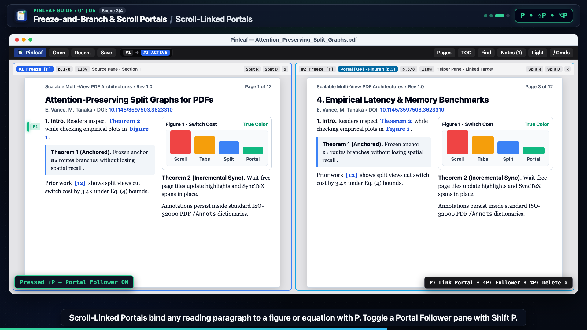
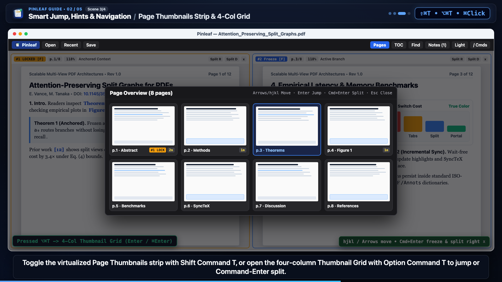
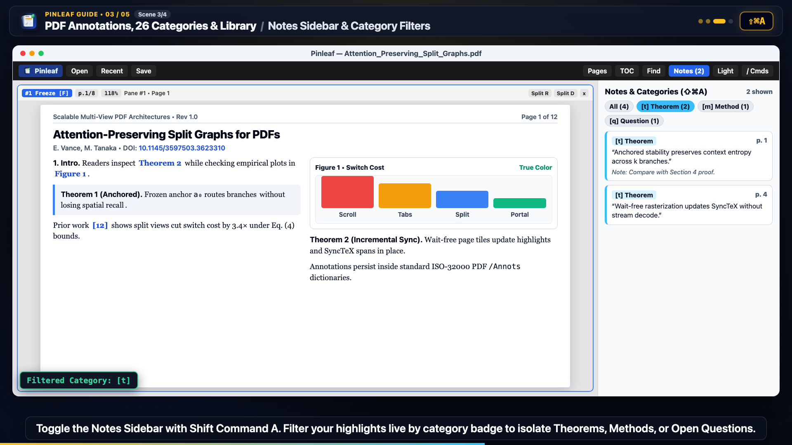
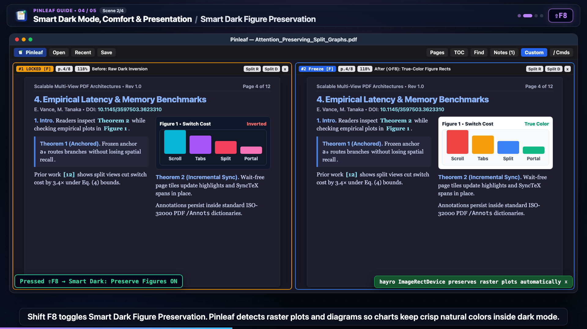
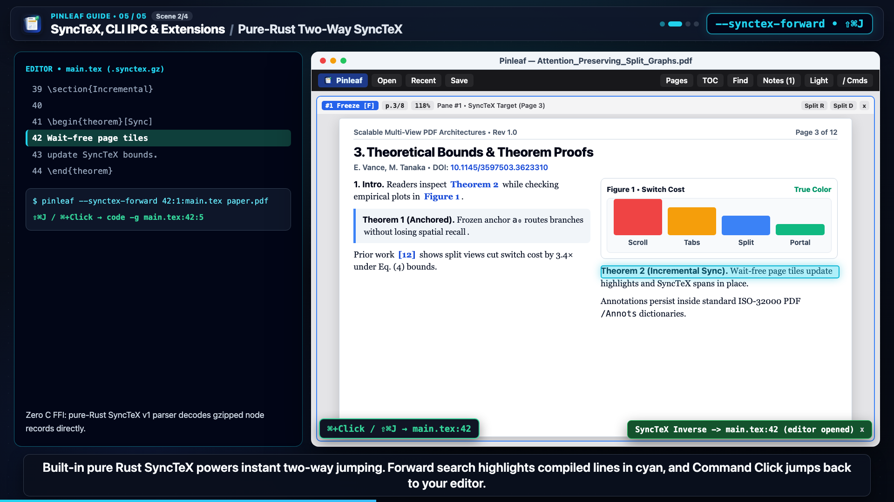

# Pinleaf Feature Tour & Workflow Recipes

This companion guide walks through every scene in Pinleaf's five introductory videos (`docs/videos/01..05-*`) and includes copy-pasteable configurations for daily academic reading and TeX/Typst authoring.

---

## Video 01 — Multi-View Freeze-and-Branch & Scroll-Linked Portals

> ▶ [Download 1080p MP4](https://github.com/zhanxw/pinleaf/releases/download/v0.2.2/01-freeze-and-portals.mp4) · [Local Repo File](videos/01-freeze-and-portals.mp4)



1. **Freeze & Split Right (`F`, `⌘D`)** — Press `F` to lock your current pane at its exact page, scroll anchor, and zoom level. Press `⌘D` (`⇧⌘D` for vertical split, `⇧⌘N` for a new OS window) to open an active branch pane without disturbing your source context.
2. **Unlimited Reading Trail (`#1 🔒 → #2 🔒 → #3`)** — Detach any pane into its own window (`⌥⌘W`) or close focused splits (`⌘W`). Clicking a reference inside any frozen pane automatically routes the active descendant viewport (`#3`).
3. **Scroll-Linked Portals (`P`, `⇧P`, `⌥P`)** — While reading a paragraph referencing a figure, press `P` to bind a portal anchor (`[P1]`) to the active target or Overview preview. Press `⇧P` to spawn or designate a `Portal Follower` pane, and `⌥P` to delete the nearest portal.
4. **Automatic Follower Sync (`LibraryStore`)** — Scrolling continuously past `[P1]` into `[P2]` switches the `Portal Follower` pane automatically (e.g., from *Figure 1* to *Equation (4)*). Portal links persist per document in `LibraryStore`.

---

## Video 02 — Go-to-Page, Thumbnails, Smart Jump & Hints

> ▶ [Download 1080p MP4](https://github.com/zhanxw/pinleaf/releases/download/v0.2.2/02-navigation-smart-jump-hints.mp4) · [Local Repo File](videos/02-navigation-smart-jump-hints.mp4)



1. **Command Palette & Go to Page (`/`, `⌥⌘G`, `<num>G`)** — Type a page number straight into the `/` Command Palette (`/4`), open the `⌥⌘G` / `^G` Go-to-Page modal, click the pane's `p.X/Y` pill, or type `<number>G` directly inside a pane.
2. **Heuristic Smart Jump & Keyboard Overview (`Enter`, `S`, `Esc`)** — Even in PDFs without embedded `/Link` annotations, Pinleaf detects `Figure N`, `Theorem N`, `Table N`, `Eq. (N)`, and numbered citations (`[12]`). Right-click or press `:` + two letters for a floating **Overview** card, then press `Enter` to jump, `S` / `⌘+Enter` to split right, `P` to bind a Portal, or `Esc` / `X` to close.
3. **Page Thumbnails Strip (`⇧⌘T`) & 4-Column Grid (`⌥⌘T`)** — Toggle the virtualized left Page Thumbnails strip (`⇧⌘T` or toolbar **Pages**, `⌘+Click` to split right), or open the 4-column Thumbnail Grid overview (`⌥⌘T`, arrow/`hjkl` movement, `Enter` to jump, `⌘+Enter` to split right).
4. **Vimium Hints (`;`, `V`), Auto-TOC (`T`), Regex Search (`⌘F`) & `Space` Scroll** — Navigate completely via keyboard with 2-letter hints (`;`, `V`), font-inferred outlines (`T`), `re:` regex search (`⌘F`), single-key marks (`m` / `` ` ``), jump history (`⌘[` / `⌘]`), and Preview-style `Space` / `⇧Space` screen scrolling.

---

## Video 03 — ISO-32000 PDF Annotations, 26 Categories & Library

> ▶ [Download 1080p MP4](https://github.com/zhanxw/pinleaf/releases/download/v0.2.2/03-annotations-categories-library.mp4) · [Local Repo File](videos/03-annotations-categories-library.mp4)



1. **Standard ISO-32000 PDF `/Annots`** — Two-column-aware selection supports highlights (`⌘H`), inline sticky notes (`⌘M`), underlines (`U`), strikeouts (`S`), and figure area marquees (`A`) with full undo/redo (`⌘Z` / `⇧⌘Z`) and atomic incremental writes (`⌘S`) readable in Apple Preview.
2. **26 Typed Highlight Categories (`H + a–z`)** — Tag new selections or re-classify existing highlights across 26 buckets (`t` Theorem, `m` Method, `d` Definition, `q` Question, …). Categories store `/Subj (pinleaf-cat:<ch>)` and `/C` directly in PDF `/Annots`.
3. **Notes Sidebar & Live Category Chips (`⇧⌘A`)** — Filter annotations by category bucket inside the sidebar to review all theorems, open questions, or experimental methods across the paper.
4. **Global Search & Citation Lookup (`⌘P`, `⇧⌘F`, `⇧⌘K`)** — Jump across your indexed library with Quick-Open Recent (`⌘P`), search highlights/notes across all PDFs (`⇧⌘F`), or open DOIs / Google Scholar queries (`⇧⌘K`).

---

## Video 04 — Smart Dark Mode, Comfort & Presentation Mode

> ▶ [Download 1080p MP4](https://github.com/zhanxw/pinleaf/releases/download/v0.2.2/04-themes-comfort-presentation.mp4) · [Local Repo File](videos/04-themes-comfort-presentation.mp4)



1. **4 Reading Themes (`F8`)** — Cycle `Light`, `Dark`, `Sepia`, and `Custom` hex palettes configured via `custom_bg_color` and `custom_fg_color`.
2. **Smart Dark Figure Preservation (`⇧F8`)** — `hayro`'s `ImageRectDevice` extracts raster figure/heatmap bounding boxes so plots retain true colors inside `Dark` and `Custom` modes instead of inverting into harsh negatives.
3. **Fit Content Width (`F10` / `W`), Reading Ruler (`R`), & Auto-Scroll (`F6`)** — Strip white side margins to fill your pane width, highlight single reading lines stepped via `j`/`k`, and cruise at 60 FPS continuous vertical scroll (`⌥+` / `⌥-` speed control).
4. **Fullscreen Presentation Mode (`F5`)** — Hide chrome/toolbars and fit slides cleanly edge-to-edge (`Esc` exits back to workspace mode).

---

## Video 05 — LaTeX/Typst Live Workflow: SyncTeX, CLI IPC & Extensions

> ▶ [Download 1080p MP4](https://github.com/zhanxw/pinleaf/releases/download/v0.2.2/05-synctex-ipc-extensions.mp4) · [Local Repo File](videos/05-synctex-ipc-extensions.mp4)



1. **800 ms Live PDF Auto-Reload** — Watches mtime changes from `latexmk -pvc` or `typst watch` while keeping scroll positions, zoom levels, and split trees intact.
2. **Pure-Rust Two-Way SyncTeX (`.synctex.gz` / `.synctex`)** — Forward-search from any editor (`pinleaf --synctex-forward <line[:col]:file.tex> <paper.pdf>`) highlights target output lines in cyan; inverse-search (`⌘+Click` or `⇧⌘J`) launches your configured editor (`code`, `cursor`, `subl`, or custom `inverse_search_command`).
3. **Unix Domain Socket CLI IPC (`--execute-command`)** — Control running Pinleaf windows over `$TMPDIR/pinleaf-$USER.sock` (mode `0600`) for `goto_page`, `toggle_thumbnails`, `toggle_thumbnail_grid`, `split_right`, `cycle_color_mode`, `search`, `toggle_presentation`, or `quit`.
4. **Shell & Python Extensions (`⇧⌘E`) & About Pinleaf** — Run custom scripts with shell-safe single-quoted placeholders (`{selected_text}`, `{file_path}`, `{page}`, `{line_text}`, `{doi}`) and `PINLEAF_*` environment variables, and click the top-left `Pinleaf` button (or macOS menu bar) for **About Pinleaf** (`Copy Version`).

---

## Sample Editor & Config Snippets (`~/.config/pinleaf/config.json`)

```json
{
  "default_color_mode": "Custom",
  "smart_dark_mode": true,
  "custom_bg_color": "#1e1e2e",
  "custom_fg_color": "#cdd6f4",
  "auto_reload": true,
  "inverse_search_command": "nvim --server /tmp/nvimsocket --remote-send \"<Esc>:{line}<CR>\"",
  "highlight_categories": {
    "t": { "label": "Theorem / Lemma", "color": "#38bdf8" },
    "m": { "label": "Method", "color": "#34d399" },
    "d": { "label": "Definition", "color": "#facc15" },
    "q": { "label": "Open Question", "color": "#fb7185" }
  },
  "extensions": [
    {
      "name": "Copy Quote & Page",
      "command": "printf '%s (p.%s)' {selected_text} {page} | pbcopy",
      "key": "ctrl-y"
    },
    {
      "name": "Export Note to Markdown",
      "command": "python3 ~/bin/pinleaf_export.py {file_path} {page} {selected_text} {doi}",
      "key": "alt-z"
    }
  ]
}
```
